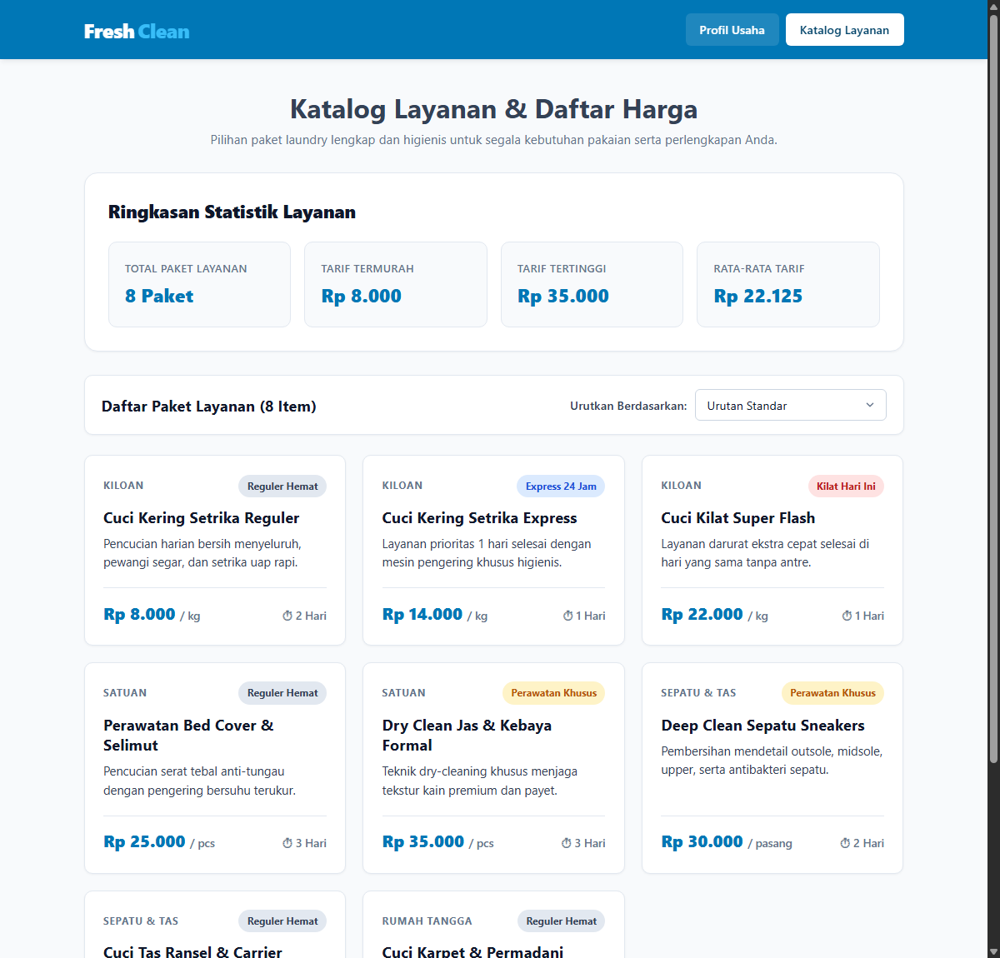
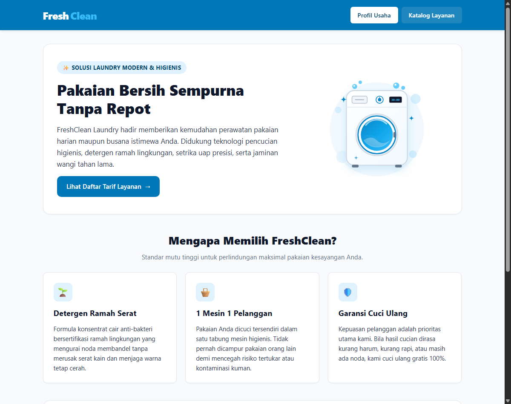

# FreshClean Laundry — Website Profil & Katalog Daftar Harga Dinamis

**Proyek Mini Individu Ujian Tengah Semester (UTS)**  
**Mata Kuliah**: Pemrograman Web (253A23W15)  
**Program Studi**: Informatika · Fakultas Teknik · Tiga Serangkai University

## 1. Identitas Mahasiswa

| Atribut | Keterangan |
| :--- | :--- |
| **Nama Lengkap** | Muhammad Fathurrohman |
| **NIM** | 025A00200003 |
| **Kelas** | A2-3A |
| **Nama Repositori** | `uts-pemweb-025A00200003` |

## 2. Deskripsi Singkat Tema (2–3 Kalimat)

**FreshClean Laundry** adalah website profil usaha dan katalog paket layanan binatu (laundry) dinamis berbasis PHP murni tanpa database. Halaman profil (`index.php`) menampilkan informasi operasional usaha, keunggulan layanan, serta ilustrasi banner usaha menggunakan kerangka HTML5 semantik. Halaman katalog (`katalog.php`) menyajikan ringkasan statistik tarif yang dihitung otomatis dari data array serta daftar kartu paket layanan yang dilengkapi fitur pengurutan (*sorting*) dinamis dan badge kategori pengerjaan otomatis.

## 3. Cara Menjalankan di Localhost

### Opsi A: Menggunakan XAMPP atau Laragon
1. Pastikan aplikasi web server lokal (XAMPP atau Laragon) sudah terpasang di komputer Anda.
2. Clone atau salin folder repositori `uts-pemweb-025A00200003` ke dalam direktori `C:\xampp\htdocs\` (pada XAMPP) atau `C:\laragon\www\` (pada Laragon).
3. Jalankan modul **Apache** melalui panel kontrol XAMPP/Laragon.
4. Buka browser dan akses alamat berikut:
   - Halaman Profil Usaha: `http://localhost/uts-pemweb-025A00200003/index.php`
   - Halaman Katalog Layanan: `http://localhost/uts-pemweb-025A00200003/katalog.php`

### Opsi B: Menggunakan PHP Built-in Web Server (Terminal / CMD)
1. Buka terminal atau Command Prompt, lalu arahkan ke dalam folder proyek:
   bash
   cd uts-pemweb-025A00200003
2. Jalankan perintah server bawaan PHP:
   bash
   php -S localhost:8000
3. Buka browser dan akses `http://localhost:8000/index.php`.

## 4. Daftar Fitur, File, dan Nama Fungsi Buatan Sendiri

Struktur proyek memisahkan penyimpanan data (`data.php`), kumpulan fungsi logika (`functions.php`), tampilan halaman (`index.php` & `katalog.php`), serta desain antarmuka (`style.css`). Setiap file PHP diawali dengan deklarasi `declare(strict_types=1);` dan mengikuti standar penulisan kode bersih PSR-12.

| No | Fitur Aplikasi | File yang Menangani | Nama Fungsi Buatan Sendiri (`functions.php`) |
| :--- | :--- | :--- | :--- |
| 1 | **Keamanan Output HTML (Anti-XSS)** — Membungkus seluruh data yang dicetak ke HTML dengan `htmlspecialchars()` | `functions.php`, `index.php`, `katalog.php` | `e(string $teks): string` |
| 2 | **Pemformatan Mata Uang Rupiah** — Mengubah nilai harga bertipe `int` menjadi format string Rupiah (contoh: `Rp 8.000`) | `functions.php`, `katalog.php` | `formatRupiah(int $nominal): string` |
| 3 | **Penentuan Label & Warna Badge Layanan** — Percabangan `match` untuk menentukan teks label dan class warna CSS (`badge-flash`, `badge-express`, `badge-premium`, `badge-reguler`) berdasarkan atribut `level` | `functions.php`, `katalog.php` | `getBadgeInfo(string $level): array` |
| 4 | **Pengurutan (Sorting) Katalog Layanan** — Mengurutkan kartu paket layanan berdasarkan pilihan pengguna melalui parameter `$_GET['sort']` (Harga Termurah, Harga Tertinggi, Estimasi Tercepat, atau Nama A–Z) | `functions.php`, `katalog.php` | `urutkanLayanan(array $daftarLayanan, string $kriteria): array` |
| 5 | **Perhitungan Ringkasan Statistik** — Menghitung jumlah total paket layanan, tarif termurah, tarif tertinggi, dan rata-rata tarif layanan | `functions.php`, `katalog.php` | `hitungRingkasanLayanan(array $daftarLayanan): array` |

## 5. Daftar Fungsi Array Bawaan PHP yang Dipakai

Proyek ini menggunakan **6 fungsi array bawaan PHP** (melebihi syarat wajib minimal 3 fungsi):

| No | Fungsi Array Bawaan | Lokasi Pemakaian | Kegunaan dalam Proyek |
| :--- | :--- | :--- | :--- |
| 1 | `count()` | `functions.php` & `katalog.php` | Menghitung jumlah total item paket layanan di dalam array multidimensi `$daftarLayanan`. |
| 2 | `array_column()` | `functions.php` (`hitungRingkasanLayanan`) | Mengambil seluruh nilai dari atribut `'harga'` pada array multidimensi menjadi array 1 dimensi untuk dihitung statistiknya. |
| 3 | `array_sum()` | `functions.php` (`hitungRingkasanLayanan`) | Menjumlahkan seluruh nominal harga layanan (`Rp 177.000`) untuk mencari nilai rata-rata tarif laundry. |
| 4 | `min()` & `max()` | `functions.php` (`hitungRingkasanLayanan`) | Mencari nilai tarif layanan paling murah (`min`: `Rp 8.000`) dan paling tinggi (`max`: `Rp 35.000`) dari daftar harga. |
| 5 | `in_array()` | `functions.php` (`urutkanLayanan`) | Memvalidasi secara ketat (*strict*) apakah input parameter `$_GET['sort']` dari pengguna termasuk dalam daftar opsi pengurutan yang sah. |
| 6 | `usort()` | `functions.php` (`urutkanLayanan`) | Mengurutkan elemen array multidimensi `$daftarLayanan` menggunakan *spaceship operator* (`<=>`) dan fungsi `strcasecmp()`. |

## 6. Tangkapan Layar (Minimal 2 Tangkapan Layar)

File tangkapan layar disimpan di dalam folder `screenshots/`:

1. **Tampilan Halaman Profil Usaha (`index.php`)**  
   Menampilkan informasi profil **FreshClean Laundry**, ilustrasi mesin cuci dengan atribut `alt` bermakna, keunggulan layanan, serta informasi jam operasional, alamat outlet, dan kontak.  
   - Lokasi berkas: `screenshots/profil.png`  
   

2. **Tampilan Halaman Katalog Layanan & Fitur Sorting (`katalog.php`)**  
   Menampilkan kartu ringkasan statistik tarif, kontrol dropdown pengurutan (*sorting*), dan daftar kartu layanan lengkap (8 item layanan) dengan badge warna kategori pengerjaan.  
   - Lokasi berkas: `screenshots/katalog.png`  
   

## 7. Sumber Referensi dan Catatan Pemakaian AI

### Sumber Referensi
- **Dokumentasi Resmi PHP (Array Functions)**: https://www.php.net/manual/en/ref.array.php — Digunakan sebagai rujukan pemakaian fungsi `array_column()`, `array_sum()`, `in_array()`, dan `usort()`.
- **Standar Gaya Penulisan Kode PHP (PSR-12)**: https://www.php-fig.org/psr/psr-12/ — Digunakan sebagai acuan deklarasi `declare(strict_types=1);`, penamaan variabel `camelCase`, dan tipe parameter/return fungsi.
- **MDN Web Docs (HTML5 Semantik & CSS Grid/Flexbox)**: https://developer.mozilla.org/en-US/docs/Web/HTML — Digunakan sebagai referensi penyusunan elemen semantik `<header>`, `<nav>`, `<main>`, `<section>`, `<article>`, `<footer>`, serta tata letak responsif.

### Catatan Pemakaian AI
- **Bagian yang Dibantu AI**: Diskusi *brainstorming* struktur atribut array paket laundry, penyusunan logika fungsi pengurutan `usort()` dan ekspresi `match` pada `functions.php`, serta penyederhanaan desain tata letak pada `style.css`.
- **Cara Memeriksa & Memverifikasi**: Seluruh kode dijalankan dan diuji langsung pada web server lokal (`localhost`), setiap fungsi dan perhitungan statistik (**jumlah layanan 8 paket**, **tarif termurah Rp 8.000**, **tarif tertinggi Rp 35.000**, dan **rata-rata tarif Rp 22.125** dari total Rp 177.000 / 8) telah dicek ulang secara manual agar sesuai 100% dengan data pada `data.php`, serta setiap baris kode telah dipelajari untuk persiapan demo langsung.